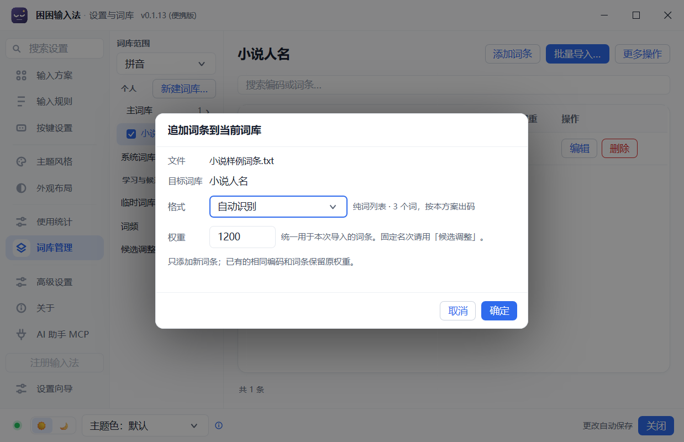
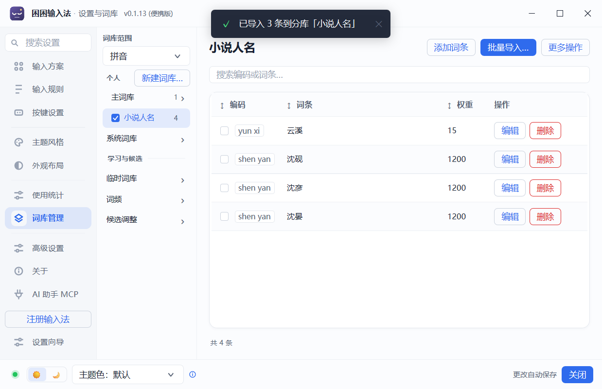

# 困困输入法 · Quicker 动作

**困困输入法（KunKunIME）是一款开源的 Windows 拼音与英文输入法。** 它支持全拼、小鹤双拼和英文补全，个人词库与设置默认保存在本机。

配套的 Quicker 动作可以一键打开拼音主词库。写小说时，把人物名和地名一次加进去，下次打拼音就能从候选里直接选出整词。

项目基于清风输入法（WindInput）独立维护，应用源码采用 [GPL-3.0-or-later 许可证](https://github.com/shuimowang/KunKunIME/blob/main/LICENSE)。从长句怎样切词、候选怎样排序，到词库管理界面怎样实现，都可以在 GitHub 上查看，也可以自行编译 Windows 版。

[查看 GitHub 源码](https://github.com/shuimowang/KunKunIME) · [从源码构建](https://github.com/shuimowang/KunKunIME#%E4%BB%8E%E6%BA%90%E7%A0%81%E6%9E%84%E5%BB%BA) · [组件与词库的来源和许可](https://github.com/shuimowang/KunKunIME/blob/main/ORIGINS.md)

[在 Quicker 安装动作](https://getquicker.net/Sharedaction?code=97a34a52-d2fd-4505-ab9b-0961e7718c53) · [手动下载动作 JSON](https://111.229.149.25/public/share/5KrzfvBkWjZPTnTEFXtodg) · [下载 Windows x64 程序包](https://111.229.149.25/public/share/tpcYS4B3SvAWygbDPBSZNg)

## 用 AI 助手管理词库

在困困输入法的设置左栏打开 **AI 助手 MCP**，或者搜索 **MCP**，即可复制 Codex 接入命令或其他客户端需要的 JSON。连好后可以先问“用困困输入法查看每页有几个候选词”，再按需管理词库和设置。[可用工具与示例](../docs/MCP.md)

## 第一次使用

在 Windows x64 上使用 Quicker 2.3.19 或更新版本。点击上方「在 Quicker 安装动作」。如果手动下载了动作 JSON，在 Quicker 面板右键目标场景标签，选「导入动作到此场景」，再选中该文件。

点面板里的「困困输入法」。首次使用可点 **「下载并打开」** 获取 Windows v0.1.13，也可以点 **「选择已有程序」**，选中解压目录里的 `KunKunIME.exe`。Quicker 文本窗口置顶后仍可继续输入拼音、查看候选并选词。

已经注册困困输入法时，动作会直接打开本机主词库。升级较早的公开版本，请从上方下载 Windows 程序包，退出困困输入法，用完整压缩包更新原安装目录后再打开。请保留随包的 `uninstall-manifest.json`。

从 v0.1.12 起，打开 **设置 → 关于** 即可自动检查最新 Windows 正式版，页首的 **困困输入法 GitHub 主页** 可直达项目源码。同页的 **卸载困困输入法…** 会打开卸载向导，默认保留个人词库与设置，也可以勾选一并清除。

要在记事本、聊天框等应用里输入自己的词，先在软件中点「注册输入法」，按 Windows 提示确认，再按 **Win + 空格** 选择「困困输入法」。

希望登录 Windows 后优先使用困困时，打开 **输入规则 → 默认状态**，点击 **设为默认输入法**。

## 给小说人物单建词库

在「词库管理」选择「拼音」，点击 **「新建词库…」**，用书名命名。已有作品词库时，点中它即可。只加一个名字可以点 **「添加词条」**；一整份名单可以保存成 UTF-8 文本，每行一个名字。

```text
沈砚
沈彦
沈晏
```

选中自己的作品词库，点右上角 **「批量导入…」**。选择名单文件后，确认弹窗里的「目标词库」是这部作品，再点 **「确定」**。软件会按当前方案生成编码，已有的同码同词保留原权重。



这三个名字的拼音都是 `shen yan`，在词表中各占一行。清理时逐行勾选，再点 **「删除所选…」** 确认一次，同一码下的其他人名继续保留。



遇到切词或候选排序问题，可以附上「输入的拼音、想打的词、实际出现的候选」，方便复现。[到 GitHub 反馈问题](https://github.com/shuimowang/KunKunIME/issues)
